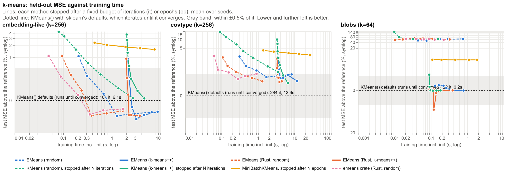
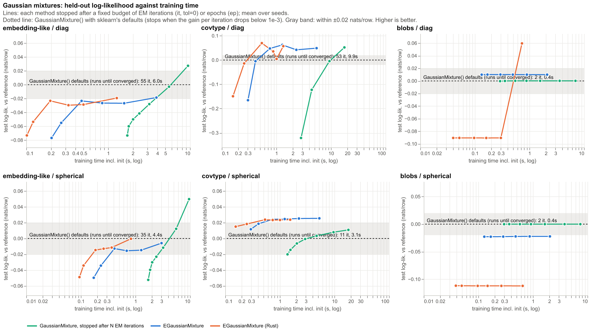

# Benchmark results

Generated by `report.py`, do not edit.

## k-means

Machine: Apple M4 Pro. Mean over 3 seeds. 

### Time to get within ±0.5% of the test MSE of `KMeans()`

| method | embedding-like | covtype | blobs |
|---|--:|--:|--:|
| EMeans (random) | 0.31s | 1.69s | never |
| EMeans (k-means++) | 2.27s | 4.08s | 0.13s |
| EMeans (Rust, random) | 0.14s | 0.45s | never |
| EMeans (Rust, k-means++) | 2.05s | 3.41s | 0.09s |
| KMeans (random), stopped after N iterations | 0.58s | never | never |
| KMeans (k-means++), stopped after N iterations | 2.49s | 4.84s | 0.09s |
| MiniBatchKMeans, stopped after N epochs | never | never | never |
| emeans crate (Rust, random) | 0.09s | 0.28s | never |
| KMeans() defaults (runs until converged) (reference) | 6.14s, 161 it | 12.61s, 284 it | 0.16s, 28 it |

### Best test MSE at any budget, relative to `KMeans()` (lower is better)

| method | embedding-like | covtype | blobs |
|---|--:|--:|--:|
| EMeans (random) | -0.13% | +0.37% | +49.97% |
| EMeans (k-means++) | -0.18% | +0.24% | -0.00% |
| EMeans (Rust, random) | -0.13% | +0.23% | +54.42% |
| EMeans (Rust, k-means++) | -0.13% | +0.21% | -1.00% |
| KMeans (random), stopped after N iterations | +0.01% | +0.61% | +59.51% |
| KMeans (k-means++), stopped after N iterations | +0.01% | +0.19% | -0.00% |
| MiniBatchKMeans, stopped after N epochs | +1.59% | +2.78% | +4.43% |
| emeans crate (Rust, random) | -0.12% | +0.30% | +55.65% |

### Cluster recovery on blobs: ARI of each method's best fit against the true labels

| method | ARI |
|---|--:|
| EMeans (Rust, k-means++) | 0.973 |
| KMeans (k-means++), stopped after N iterations | 0.967 |
| EMeans (k-means++) | 0.967 |
| KMeans() defaults (runs until converged) | 0.967 |
| MiniBatchKMeans, stopped after N epochs | 0.96 |
| EMeans (random) | 0.848 |
| EMeans (Rust, random) | 0.835 |
| emeans crate (Rust, random) | 0.828 |
| KMeans (random), stopped after N iterations | 0.83 |

## Gaussian mixtures

Machine: Apple M4 Pro. Mean over 3 seeds. 

### Time to get within 0.02 nats/row of the test log-likelihood of `GaussianMixture()`

| method | embedding-like / diag | covtype / diag | blobs / diag | embedding-like / spherical | covtype / spherical | blobs / spherical |
|---|--:|--:|--:|--:|--:|--:|
| GaussianMixture, stopped after N EM iterations | 5.54s | 9.38s | 0.29s | 3.21s | 1.56s | 0.30s |
| EGaussianMixture | 3.88s | 0.41s | 0.13s | 0.41s | 0.29s | never |
| EGaussianMixture (Rust) | 1.27s | 0.26s | 0.73s | 0.19s | 0.16s | never |
| GaussianMixture() defaults (runs until converged) (reference) | 5.98s, 55 it | 9.88s, 53 it | 0.39s, 2 it | 4.41s, 35 it | 3.15s, 11 it | 0.37s, 2 it |

### Best test log-likelihood at any budget, nats/row relative to `GaussianMixture()` (higher is better)

| method | embedding-like / diag | covtype / diag | blobs / diag | embedding-like / spherical | covtype / spherical | blobs / spherical |
|---|--:|--:|--:|--:|--:|--:|
| GaussianMixture, stopped after N EM iterations | +0.027 | +0.052 | +0.000 | +0.050 | +0.011 | +0.000 |
| EGaussianMixture | -0.019 | +0.062 | +0.010 | -0.006 | +0.025 | -0.022 |
| EGaussianMixture (Rust) | -0.019 | +0.070 | +0.060 | -0.000 | +0.024 | -0.112 |

### Full covariance, for comparison: `GaussianMixture(covariance_type="full")` defaults

EGaussianMixture does not support full covariances. This is what one would add over the diagonal default.

| data | nats/row over diag | seconds |
|---|--:|--:|
| embedding-like | 7.59 | 43.1 |
| covtype | 6.35 | 38.0 |
| blobs | 0.14 | 1.8 |

### Sample realism: AUC of a classifier telling 20k samples from 20k real held-out rows (0.5 = indistinguishable)

covtype's columns are integer-valued, so Gaussian samples are always easy to spot there.

| model | embedding-like | covtype | blobs |
|---|--:|--:|--:|
| GaussianMixture() defaults (runs until converged) / diag | 0.592 | 0.995 | 0.546 |
| GaussianMixture() defaults (runs until converged) / spherical | 0.599 | 0.999 | 0.82 |
| GaussianMixture() defaults, full covariance / full | 0.595 | 0.993 | 0.556 |
| EGaussianMixture / diag, 5 ep | 0.597 | 0.996 | 0.539 |
| EGaussianMixture / spherical, 5 ep | 0.597 | 0.999 | 0.822 |
| EGaussianMixture / diag, 50 ep | 0.598 | 0.995 | 0.541 |
| EGaussianMixture / spherical, 50 ep | 0.606 | 0.999 | 0.821 |
| EGaussianMixture (Rust) / diag, 5 ep | 0.596 | 0.996 | 0.545 |
| EGaussianMixture (Rust) / spherical, 5 ep | 0.594 | 0.999 | 0.823 |
| EGaussianMixture (Rust) / diag, 50 ep | 0.599 | 0.996 | 0.536 |
| EGaussianMixture (Rust) / spherical, 50 ep | 0.601 | 0.999 | 0.822 |
| real rows (floor) | 0.499 | 0.498 | 0.504 |

### Cluster recovery on blobs: ARI of each method's best fit against the true labels

| covariance | method | ARI |
|---|--:|--:|
| diag | EGaussianMixture | 0.967 |
| diag | EGaussianMixture (Rust) | 0.975 |
| diag | GaussianMixture() defaults (runs until converged) | 0.967 |
| diag | GaussianMixture, stopped after N EM iterations | 0.967 |
| spherical | EGaussianMixture | 0.967 |
| spherical | EGaussianMixture (Rust) | 0.967 |
| spherical | GaussianMixture() defaults (runs until converged) | 0.967 |
| spherical | GaussianMixture, stopped after N EM iterations | 0.967 |

