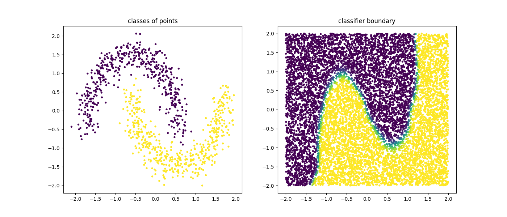
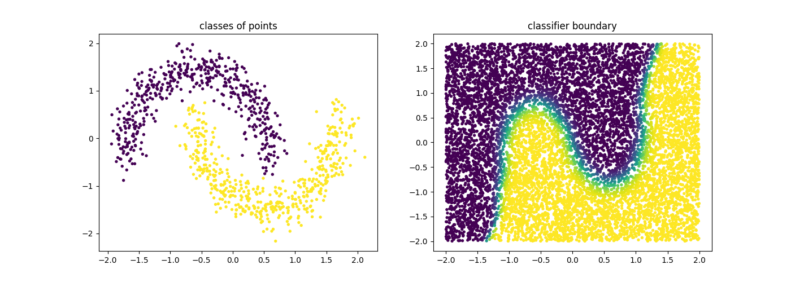
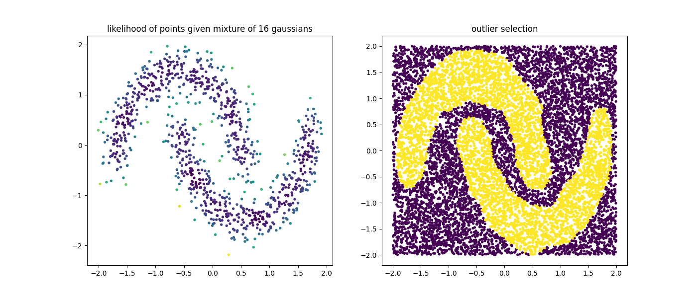
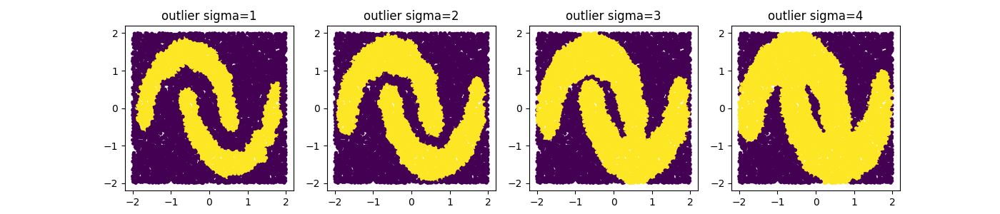
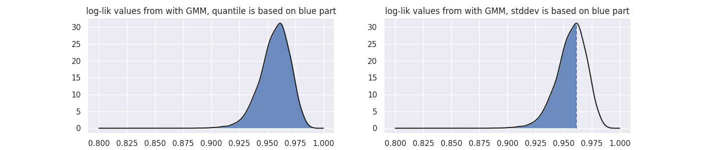

# Mixture Methods

Gaussian Mixture Models (GMMs) are flexible building blocks for other machine learning algorithms.

This is in part because they are great approximations for general probability distributions but also because they remain somewhat interpretable even when the dataset gets very complex.

This package makes use of GMMs to construct other algorithms. In addition to the [GMMClassifier][gmm-classifier-api] and [GMMDetector][gmm-classifier-api], this library also features a [BayesianGMMClassifier][bayes_gmm-classifier-api], [BayesianGMMDetector][bayes_gmm-outlier-detector-api] and [BayesianKernelDensityClassifier][bayes_kde-classifier-api] as well. These methods offer pretty much the same API, but will have internal methods to figure out what number of components to estimate. These methods tend to take significantly more time to train, so alternatively you may also try doing a proper grid search to figure out the best number of components for your use-case.

## Classification

Below is some example code of how you might use a [GMMClassifier][gmm-classifier-api] from sklego to perform classification.

```py title="GMMClassifier"
--8<-- "docs/_scripts/mixture-methods.py:gmm-classifier"
```



Below is example code on how to use [BayesianKernelDensityClassifier][bayes_kde-classifier-api] from sklego to fit a non-parametric Kernel Density to each target class independently.

```py title="BayesianKernelDensityClassifier"
--8<-- "docs/_scripts/mixture-methods.py:bayes-kde-classifier"
```



## Outlier Detection

Below is some example code of how you might use a GMM from sklego to do outlier detection.

Note that the [GMMOutlierDetector][gmm-outlier-detector-api] generates prediction values that are either -1 (outlier) or +1 (normal).

```py title="GMMOutlierDetector"
--8<-- "docs/_scripts/mixture-methods.py:gmm-outlier-detector"
```



Remark that with a GMM there are multiple ways to select outliers. Instead of selection points that are beyond the likely quantile threshold one can also specify the number of standard deviations away from the most likely standard deviations a given point it.

??? example "Different thresholds"
    ```py
    --8<-- "docs/_scripts/mixture-methods.py:gmm-outlier-multi-threshold"
    ```



### Detection Details

The outlier detection methods that we use are based on the likelihoods that come out of the estimated Gaussian Mixture.

Depending on the setting you choose we have a different method for determining if a point is inside or outside the
threshold.

1. If the `"quantile"` method is used, we take all the likelihood scores found that the GMM associates on a training dataset to determine where to set a threshold. The threshold value must be between 0 and 1 here.
2. If the `"stddev"` method is used, then the threshold value is now interpreted as the number of standard deviations lower than the mean we are. We only calculate the standard deviation on the lower scores because there's usually more variance here.
    !!! note
        This setting allows you to be much more picky in selecting than the `"quantile"` one since this method allows you to be more exclusive than the `"quantile"` method with threshold equal to one.



As a sidenote: this image was generated with some dummy data, but its code can be found below:

!!! example "Code for plot generation"
    ```py
    --8<-- "docs/_scripts/mixture-methods.py:outlier-mixture-threshold"
    ```

## Fast Gaussian mixtures with EGaussianMixture

[`EGaussianMixture`][egmm-api] fits a Gaussian mixture with diagonal or spherical covariances, much like
`sklearn.mixture.GaussianMixture`, but trains it the way [e-means](clustering.md#e-means) trains k-means. Instead of
full EM iterations over all of the data, it walks over the data in mini-batches. Every batch gets an E-step under the
current parameters, and the responsibility-weighted sums of $x$ and $x^2$ then update each component's weight, mean
and variance through an exponential moving average. After the last pass the parameters come from one exact M-step on
the sums of that pass.

```py
from sklearn.datasets import make_blobs
from sklego.mixture import EGaussianMixture

X, _ = make_blobs(n_samples=100_000, centers=50, n_features=32, random_state=42)

gmm = EGaussianMixture(n_components=50, covariance_type="diag", random_state=42).fit(X)
gmm.score(X)               # average log-likelihood per row
gmm.predict_proba(X[:5])   # responsibilities
samples, labels = gmm.sample(1_000)
```

It has the usual mixture API (`predict`, `predict_proba`, `score_samples`, `score`, `sample`, `bic`, `aic`), and the
fitted `weights_`, `means_`, `covariances_` and `precisions_cholesky_` use the same layout as scikit-learn.

By default the means start from an `EMeans` fit seeded with k-means++ on a small subsample. The batch size and step
size come from the e-means scaling laws, with a batch of at least 64 rows per component and a step size capped at
0.3. Without those limits the k-means laws push the step size to 1 on longer runs, which turns the
moving average into noisy mini-batch EM that gets worse with more epochs.

`notebooks/emeans_benchmark.py` compares it to `GaussianMixture` with scikit-learn's defaults, timing every fit
(initialisation included) and scoring it on held-out rows. On one run (Apple M4 Pro, one seed):

| data | covariance | `GaussianMixture()` defaults | `EGaussianMixture()` |
|---|---|---|---|
| embedding-like: 100k rows, 100-d, unit norm, 64 components | diag | 6.3s, 88.977 nats/row | **0.50s**, 88.945 (5 epochs) |
| | spherical | 4.8s, 88.880 | **0.24s**, 88.836 (2 epochs) |
| covtype: 464k rows, 10 numeric columns, 32 components | diag | 10.8s, -8.862 | **0.40s**, -8.813 (2 epochs) |
| | spherical | 2.9s, -10.980 | **0.39s**, -10.959 (2 epochs) |

So the speedup ranges from about 7 to 27 times, for a held-out log-likelihood that is at most 0.05 nats per row below EM, and sometimes above it.

!!! tip "Tuning `alpha` and `batch_size`"

    A larger `alpha` can give a slightly better fit, but only when every component sees enough rows per batch. As a
    rule of thumb, keep `batch_size / n_components` at about 200 times `alpha` or more: `alpha=0.6` wants about 128
    rows per component in a batch. With smaller batches, a large `alpha` makes the fit *worse* as you add epochs.

!!! info "Full covariances"

    Only `"diag"` and `"spherical"` covariances are supported for now. If you need full covariances, a fitted
    `EGaussianMixture` can still provide a fast starting point: pass its `means_` as `means_init` to
    `sklearn.mixture.GaussianMixture(covariance_type="full")`.

[gmm-classifier-api]: ../../api/mixture#sklego.mixture.gmm_classifier.GMMClassifier
[bayes_gmm-classifier-api]: ../../api/mixture#sklego.mixture.bayesian_gmm_classifier.BayesianGMMClassifier
[gmm-outlier-detector-api]: ../../api/mixture#sklego.mixture.gmm_outlier_detector.GMMOutlierDetector
[bayes_gmm-outlier-detector-api]: ../../api/mixture#sklego.mixture.gmm_outlier_detector.BayesianGMMOutlierDetector
[bayes_kde-classifier-api]: ../../api/neighbors#sklego.neighbors.BayesianKernelDensityClassifier
[egmm-api]: ../../api/mixture#sklego.mixture.egmm.EGaussianMixture
