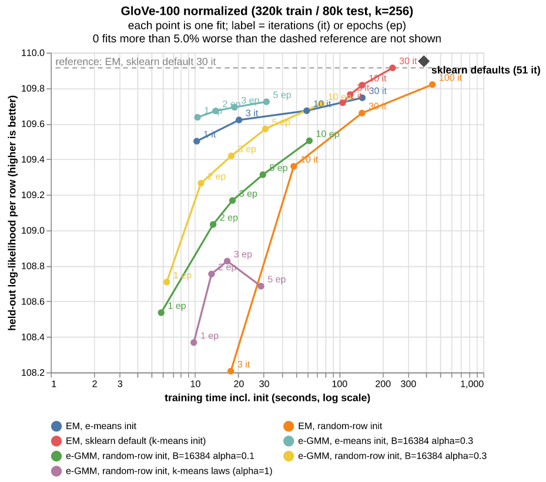

# e-GMM: e-means style updates for Gaussian mixtures (research notes)

Status: **promoted to the library as `sklego.mixture.EGaussianMixture`.** This folder keeps the research that led
there. `egmm.py` is the original diagonal prototype, and the scripts and `results/*.csv` below were produced with it.
The scripts are left as they were so the recorded numbers stay reproducible.

## What changed on the way into the library

- **Covariances:** `covariance_type` is `"diag"` or `"spherical"`. Spherical keeps a moving average of `|x|^2`
  instead of `x^2`.
- **Init:** `init="e-means"` (the default) seeds k-means++ on a subsample of `64 * k` rows, runs `EMeans` for 2
  epochs, and takes weights, means and variances from one hard-assignment pass. Random e-means starts lost 1.6
  nats/row on well separated blobs (two centroids in one blob). Subsampled k-means++ matched full k-means++ over 5
  seeds, and costs 0.13s instead of 3.1s at 320k x 100, k=256.
- **Defaults:** `batch_size = max(k-means law, 64 * k)` rounded to a power of two (capped at n), and
  `alpha = min(k-means law, 0.3)`.
- **Speed and robustness:** one GEMM for the E-step (`[x, x^2] @ W`) and one for the statistics (`resp.T @ [x, x^2]`),
  an in-place logsumexp, chunked scoring, and data centred around its mean, so large offsets do not wreck
  `E[x^2] - E[x]^2`.

### How the defaults were picked

Sweeps over `batch_size` x `alpha` x epochs on blobs (8-d, k=20), overlapping blobs (64-d, k=128), covtype (10
numeric columns, k=32 and 128) and an embedding-like set (250k rows, 100-d on the unit sphere, k=64 and 256), from
the e-means init:

- `alpha=1` (what the k-means laws give for longer runs) can lose 1.6-13.6 nats/row when there are 64 or fewer rows
  per component per batch, and gets *worse* with more epochs, the same thing seen on GloVe.
- The stable region is roughly `batch_size / k >= 200 * alpha`. Both (64 rows per component, `alpha=0.3`) and (128,
  `alpha=0.6`) are stable everywhere, and their test log-likelihoods match to within 0.02 nats/row on every set.
- (64, `alpha=0.6`) is 0.04-0.23 nats/row better on covtype and the 256-component embedding set, but degrades with
  epochs on the 64-component embedding set (88.96 -> 88.55 from 3 to 10 epochs). So the default stays at the safe
  `alpha <= 0.3`.
- Batches of 256 rows per component or more are stable but converge more slowly per epoch.

## The algorithm (`egmm.py`)

Plain EM for a **diagonal** Gaussian mixture, with the M-step replaced by the e-means EMA update. Per minibatch of `B`
rows:

1. E-step: responsibilities `r` (rows x components) under the current weights/means/variances.
2. Soft sufficient statistics per component: `n_j = sum r`, `s_j = sum r x`, `q_j = sum r x^2`.
3. EMA update with step `a` (cosine-decayed from `alpha`, same schedule as `EMeans`):
   - `mass_j <- (1 - a) mass_j + a n_j`
   - `mean_j <- mean_j + (a n_j / mass_j) (s_j / n_j - mean_j)`, same for the second moment with `q_j / n_j`
   - `var_j = E[x^2]_j - mean_j^2 + reg_covar`, `weight_j = mass_j / sum(mass)`
4. During the last epoch the plain sums are accumulated too, and a final full M-step is taken from them (as faiss does
   for e-means).

Init: means from the caller (random rows, k-means++, or e-means centroids); all variances start at the global variance.
`batch_size` / `alpha` default to the **k-means** scaling laws from `sklego.cluster.emeans` - which turned out to be wrong
for GMM (see below).

## Results

All numbers: diagonal covariances, time includes initialisation, held-out average log-likelihood per row (higher is
better). Raw numbers are in `results/*.csv`.

### GloVe-100 (400k words, L2-normalised, 320k train / 80k test, k=256), one seed

| method | time | test loglik/row |
|---|---|---|
| `GaussianMixture()` defaults (k-means init, 51 it) | 387s | 109.95 |
| EM, sklearn default init, 1 it | 106s (almost all k-means init) | 109.72 |
| EM, e-means init (Rust `emeans`, ~1s), 30 it | 145s | 109.75 |
| e-GMM, e-means init, B=16384, alpha=0.3, 1 ep | 10s | 109.64 |
| e-GMM, e-means init, B=16384, alpha=0.3, 5 ep | 31s | 109.72 |
| e-GMM, e-means init, B=16384, alpha=0.3, 20 ep | 104s | 109.87 |
| e-GMM, random rows, k-means scaling laws (alpha -> 1) | 17-29s | 108.4-108.8 (gets *worse* with epochs) |

Takeaways:

- **The k-means scaling laws do not transfer.** At 3+ epochs they set `alpha=1`, so the EMA has no memory and e-GMM
  degenerates into noisy minibatch EM (~64 rows per component per batch in 100-d). Capping alpha (0.1-0.3) with large
  batches fixes it.
- **e-means init + e-GMM is the best time/quality combination:** sklearn-default-1-iteration quality ~3.5x faster, and
  still improving at 20 epochs (0.08 nats/row behind converged EM at ~1/3 of the time).
- 0.08-0.23 nats/row is *not* negligible for density use (exp(0.23) ~ 1.26x typical density ratio).

### Sampling fidelity (`sampling_glove.py`)

The user's target use case is **sampling from the same distribution**. Test: draw 40k samples per model, train a
`HistGradientBoostingClassifier` to tell them from 40k real held-out rows, report AUC on a further 40k/40k
(0.5 = indistinguishable). "renorm" re-projects samples onto the unit sphere first (GloVe rows have norm 1).

| model | test loglik | AUC raw | AUC renorm |
|---|---|---|---|
| real train rows (floor) | - | 0.50 | 0.50 |
| e-GMM 1 / 5 / 20 ep | 109.64 / 109.72 / 109.87 | 0.61 / 0.61 / 0.60 | 0.60 / 0.59 / 0.60 |
| EM, e-means init, 10 it | 109.67 | 0.61 | 0.60 |
| `GaussianMixture()` defaults | 109.95 | 0.60 | 0.56 |

All diagonal models are about equally distinguishable from real data; nearest-real-row distance of samples is ~0.85 for
every model vs 0.73 for real test rows. **The diagonal restriction looks like the bigger limit for sampling, not EM vs
e-GMM.** `sampling_glove_full_cov.py` (sklearn full-covariance EM, e-means init) is the reference to check that; it is
slow (k=256 full 100x100 covariances) and had not finished when this PR was opened.

### Earlier synthetic / tabular runs (`results/synthetic_and_covtype_frontier.csv`)

- covtype, 10 numeric columns (150k x 10, k=32): e-GMM reached EM-level test loglik ~30x faster.
- Well separated anisotropic blobs: tie; EM from k-means init converges in 1-2 iterations.
- From random rows both EM and e-GMM get stuck 2-10 nats behind on blobs.

## Suggested next steps (as written for the handoff)

1. Wait for / rerun `sampling_glove_full_cov.py`. If full covariance gets AUC clearly closer to 0.5, `covariance_type="full"`
   is required, not optional.
2. Promote to `sklego.mixture.EGaussianMixture` mirroring `GaussianMixture`'s API: `covariance_type` in
   {"diag", "spherical", "full"} (full = EMA of `sum r x x^T` per component), `n_epochs`, `batch_size`, `alpha`,
   `init` (default: e-means centroids), `reg_covar`, `random_state`; `score_samples`, `sample`, `predict_proba`.
3. GMM-specific defaults: a small grid over `batch_size` x `alpha` x epochs on GloVe + covtype + blobs; the k-means laws
   must not be reused as-is. Consider a guard against component collapse (small batch + large alpha).
4. Add a multi-seed run; everything on GloVe above is one seed.

## Reproducing

Scripts are meant to be run from this folder with the scikit-lego dev env plus `emeans` (PyPI, the Rust crate),
`polars`, `altair`, `vl-convert-python`. They expect `glove100.npy`: the 400k x 100 GloVe 6B vectors as a float array
(not included, ~160MB; any 100-d GloVe 6B export works). Runtimes on a 2-core VM: `frontier_glove.py` ~25 min,
`frontier_glove_capped_alpha.py` ~10 min, `sampling_glove.py` ~15 min, `sklearn_defaults.py` ~10 min.

- `python chart.py gmm results/frontier_glove.csv results/frontier_glove_capped_alpha.csv out.png` redraws the chart.
